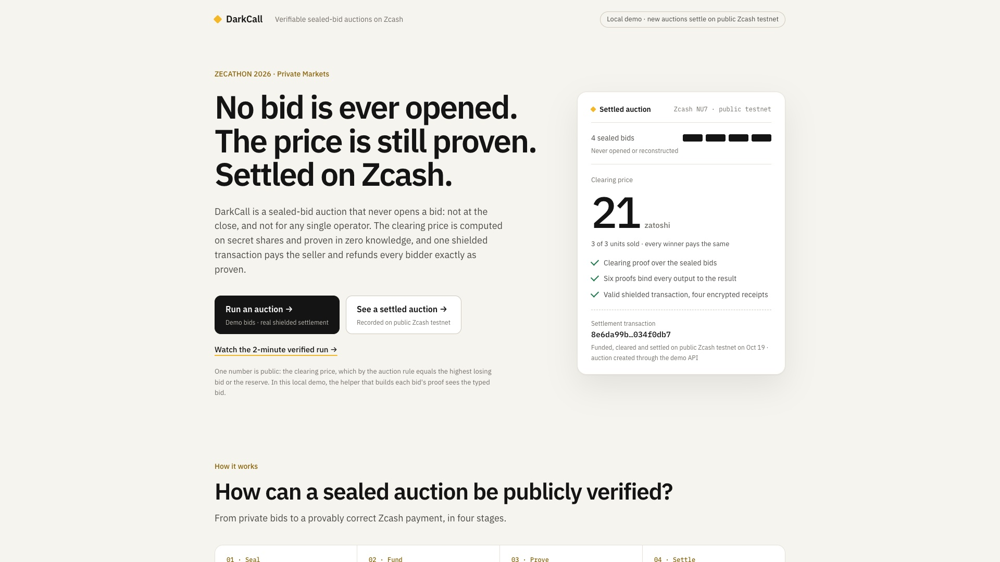
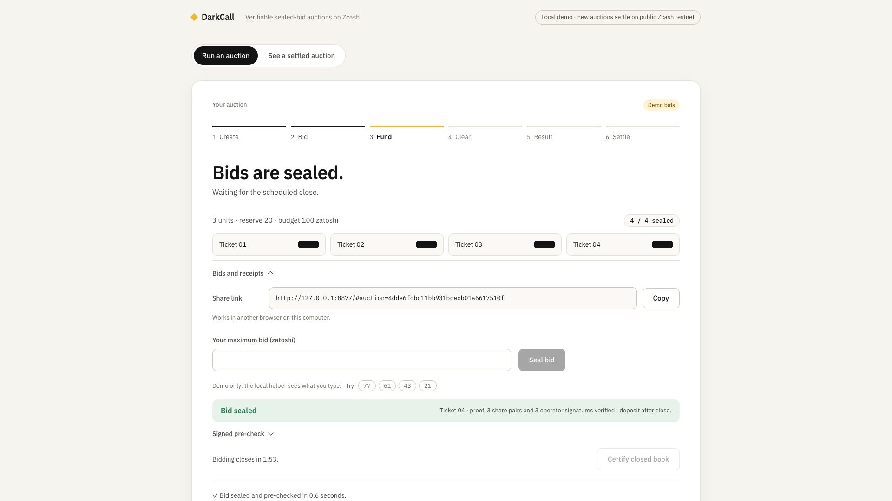
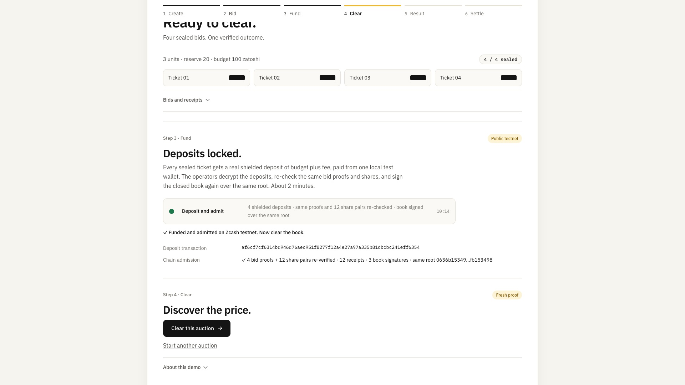
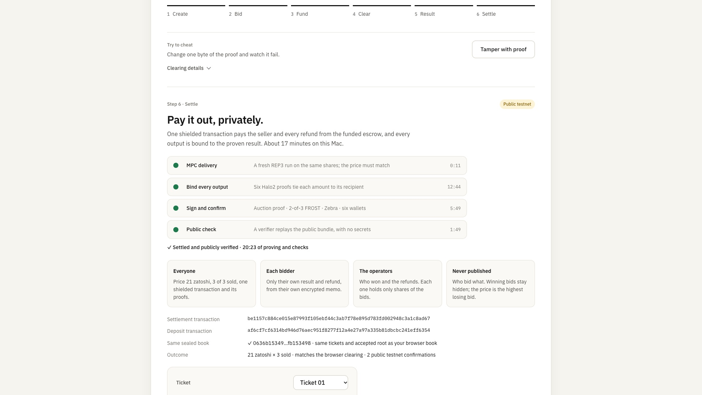
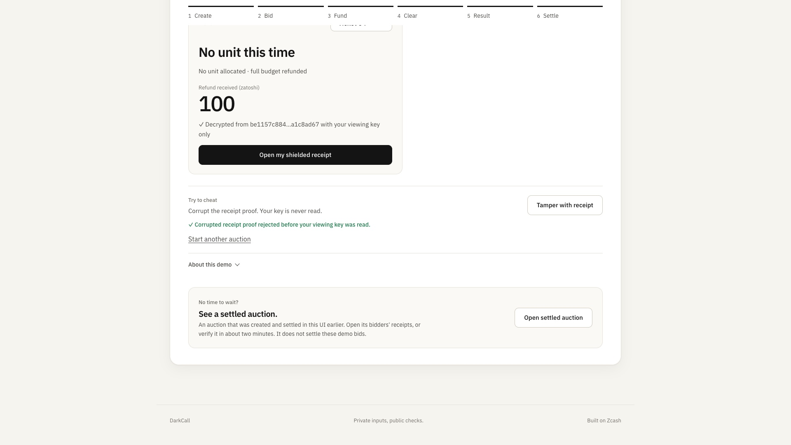

# DarkCall

**Sealed-bid auctions on Zcash. Bids stay sealed. The price is proven.
Settlement is one shielded transaction that anyone can verify.**

ZECATHON 2026 · Private Markets track. **[Watch the 2-minute demo](demo/media/v2/darkcall-demo-v2.mp4)**:
one real auction, from creation to shielded receipts, with every time cut labeled.



> **Demo scope, up front.** This prototype runs every role on one machine. The
> local bidder helper that builds each bid's proof and shares sees the typed
> demo bid, and the three operators share a host. The protocol keeps bids from
> the operators and the public; this demo shows that machinery working, not
> isolation between separate parties. Details are under
> [Trust model and limits](#trust-model-and-limits).

A seller offers identical units. Bidders commit secret maximum bids that are
split into secret shares for three operators. The operators compute one uniform
clearing price with multi-party computation (MPC) and jointly prove it with a
zero-knowledge proof. The computation never reconstructs the bid list. One shielded NU7
transaction pays the seller, refunds every bidder and carries each bidder's
encrypted receipt. Six Halo2 proofs bind every output of that transaction to the
proven auction result. A public verifier checks all of it without a single
secret. Each bidder decrypts only their own outcome.

```
 browser / bidder                 three operators                         Zcash (NU7 regtest)
 ────────────────                 ───────────────                         ───────────────────
 max bid ─► commitment + REP3 ──► check client ZK proof + shares
            shares + ZK proof     sign acceptance receipts
 deposit budget+fee ────────────────────────────────────────────────────► 2-of-3 FROST (DKG) escrow
                                  cutoff → sign final book (root)
                                  REP3 MPC: price, winners, refunds  ─┐
                                  coNoir proof (no bid reconstructed) │
                                  6 Halo2 output-binding proofs ──────┤
                                  2-of-3 FROST signatures ────────────┴─► one shielded tx:
                                                                          seller · 4 refunds+memos · fee
 open own memo with own key ◄───────────────────────────────────────────── 
 anyone: verify public bundle (proofs + tx + certificate), no secrets
```

## Who it is for

Anyone who sells a batch of identical units and wants one fair price: event
seats, allocation slots in a token or NFT drop, sponsorship or ad slots, or
reserved compute. A uniform-price sealed-bid auction is the fair format: every
winner pays the same price, set by the highest losing bid (or the reserve), so a
bidder who wants one unit does best by bidding their true value.
DarkCall adds what on-chain auctions lack. Outsiders cannot see what you bid or
whether you won. By design, no single operator holds your bid. Payment is
shielded ZEC, and the result is still verifiable.

## What is different

Other auctions make you choose: hide the bids, or let everyone check the price.
DarkCall does both, then pays out in shielded ZEC.

| | **DarkCall** | Open on-chain auction | Commit–reveal | Trusted auctioneer |
| --- | --- | --- | --- | --- |
| Bids hidden from the public | **Yes, never opened** | No | Until the reveal | Yes |
| Bids hidden from whoever runs it | **Yes, from any single operator** | No | No | No |
| Anyone can check the price | **Yes, by zero-knowledge proof** | Yes | Yes, by opening every bid | No, you trust it |
| Payments and refunds stay private | **Yes, one shielded transaction** | No | No | Off-chain, trusted |
| Payout provably follows the result | **Yes, six output proofs** | Yes, by contract | Yes, by contract | No |

Common designs compared, not specific projects. "Any single operator" is the
REP3 bound: two colluding operators could reconstruct bids (see
[Trust model and limits](#trust-model-and-limits)).

Typical sealed-bid designs either trust an auctioneer with every bid or **reveal
the bids after the close** so that anyone can audit the result (commit-reveal, or
publishing a viewing key). DarkCall checks the result **without opening the
bids**. Neither the public nor any single operator learns who bid what, and the
winners' maximum bids are never revealed:

| Public | Hidden from the public (operators learn winners and refunds) |
| --- | --- |
| Auction terms, accepted-book root, clearing price, units sold | Who bid what; every winner's maximum bid |
| A shielded transaction and the proofs that bind its six outputs to the result | Who won and who lost; each refund; recipient addresses |
| Operator signatures over the accepted book | Bidder ↔ deposit linkage (shielded) |

The clearing price is, by the auction rule, the highest losing bid (or the
reserve). That one number is public; who placed it is not.

Correctness comes from proofs, not from disclosure: a coNoir (REP3) proof of the
clearing over the committed bids, a Halo2 proof per transaction output, native
Zcash authorization and an operator-signed accepted book.

## It runs, end to end, for an auction you create

On October 19, 2026 an auction was **created, bid on, funded, cleared and
settled by clicking through the browser UI**, in protocol order, on an isolated
Zebra 7.0.0-rc.0 NU7 regtest. The same sealed tickets, commitments, shares and
accepted root `2d619728…558d12f9` carried through every step:

| Step | Result |
| --- | --- |
| Create + 4 sealed demo bids (77, 61, 43, 21) | 4 client ZK input proofs, 12 REP3 share-pair checks, 3 operator signatures per bid (pre-check) |
| Fund on Zcash | 4 real shielded deposits, tx `5e9432e5…d72f14be`, 2 confirmations. Same 4 proofs + 12 pairs re-verified against the deposits; operator certificate over the **same root** (121 s) |
| Clear | REP3 price **21**, 3 sold, coNoir proof verified in 7.8 s, after funding |
| Settle | Fresh REP3 delivery on the same shares, 6 Halo2 output bindings, 2-of-3 DKG FROST; Zebra accepted tx `e3ffa436…84769754` with 2 confirmations (driver 912 s) |
| Payout | 6 wallets scanned their exact notes: refunds 79/79/100/79, seller 63, operator fee 30000 |
| Public check | Public-only verifier passed in 105 s: native authorization, 6 bindings, auction proof, certificate |
| Own receipts | Ticket 01 WON / 79 and Ticket 04 LOST / 100, each decrypted from its own memo with its own key; a corrupted receipt proof was rejected before key use |

The scripted run of the same API (`scripts/check_fresh_settlement.py`) repeats
the flow. It also checks that clearing or settling before funding, a tampered
receipt proof, a foreign ticket capability and a concurrent proof are all
refused. Four committed public bundles can be verified without secrets: this
six-step auction, two earlier browser-created books from Oct 18, and the Oct 5
recorded settlement `47019e02…a211938` with fixture bids. Exact records:
[browser settlements](evidence/2026-10-18-fresh-book-native-settlement.json),
[recorded settlement](evidence/2026-10-05-canonical-funded-nu7-memo-auction.json).

<table>
<tr><td></td>
<td></td></tr>
<tr><td>Four sealed tickets: each a client ZK proof plus three operator signatures; no value shown.</td>
<td>Fund on Zcash: real shielded deposits, admitted over the same root, before any clearing.</td></tr>
<tr><td></td>
<td></td></tr>
<tr><td>Settle: MPC delivery, six output bindings, FROST signing, confirmations, public check.</td>
<td>Each ticket opens only its own shielded receipt; a corrupted proof is rejected before the key is read.</td></tr>
</table>

Frames from the video run (auction `b9c23d7d…`, settlement `e3056995…51caf779`); see
[demo/media/v2/manifest.json](demo/media/v2/manifest.json).

## Try it

**Verify every committed settlement in a clean Linux container, with one
command.** It needs Docker and at least 15 GB of free disk; the build takes
about 20 minutes the first time:

```sh
scripts/docker_verify.sh
```

It builds every pinned tool from source using only committed files, verifies
all four committed bundles, and checks that a corrupted proof is rejected. It
passed on Oct 19 on linux/arm64
([record](evidence/2026-10-18-clean-room-linux-verification.json)). Remove the
image afterwards with `docker image rm`.

**Or verify on the host.** Build the pinned tools
([reproduce.md](docs/reproduce.md)), then run:

```sh
./verify.sh --funded demo/artifacts/browser-auction-nu7-v2 \
  --authority demo/authority/browser-auction-nu7-v2.json
```

**Run the whole product locally.** You need the pinned tools, Docker, and the
local NU7 regtest node and test bank ([regtest.md](docs/regtest.md)).

```sh
python3 scripts/regtest_nu7_node.py start
./demo.sh            # http://127.0.0.1:8877
```

Then: **Try DarkCall → Create auction** (default terms) → seal four demo bids →
wait for the close → **Certify closed book → Fund on Zcash** (real deposits and
chain admission, about 2 minutes) **→ Clear this auction → Open my result →
Settle on Zcash** (about 17 minutes on a 16 GiB M1, with live progress). After it finishes, **Open my shielded receipt** decrypts your
memo from the settlement transaction, and **Tamper with receipt** shows a
corrupted proof being refused before your key is read.
`./demo.sh --public-only` serves a key-less view that can verify and reject
tampering.

For a scripted run over the same HTTP API:

```sh
python3 -B scripts/check_fresh_settlement.py --output .local/fresh-settlement-check.json
```

## Trust model and limits

DarkCall is a working prototype, not production custody. These are its exact
assumptions:

- **Bid secrecy** holds against at most one semi-honest corrupt operator (REP3).
  Two colluding operators can reconstruct bids. It is not malicious-secure MPC.
- **Custody** is 2-of-3 FROST from a DKG. No escrow master key exists, but two
  colluding signers can move funds, and bidders have no unilateral refund path.
- **Operators see outcomes.** They hold escrow viewing capability and learn refunds and
  winners.
- **The price is one bid.** Under these rules the public clearing price equals
  the highest losing bid, or the reserve. That single value is public by design;
  who placed it is not. Small books and repeated auctions allow further
  inference.
- **The demo helper sees typed bids.** In this local demo, the localhost helper that builds the client
  proof sees the typed demo bid. Deposits come from one local test wallet right
  after the close; in a deployment each bidder's own wallet deposits. All
  three operators run on one machine.
- **Funding is attested, not proven.** Admission signatures attest funding; they are not a public ZK funding
  proof. The public bundle proves transaction validity and output binding, not
  chain inclusion. Confirmations are observed on a controlled regtest node.
- **Regtest only.** It runs on an isolated regtest: no public testnet or mainnet funds.
- **Fixed size.** The circuits have four bid slots and six outputs. The native settlement path
  supports the default terms (3 units, budget 100, reserve 0 or 20).

An earlier delivery design leaked refunds to a two-candidate guess. We reproduced
the attack, withdrew the claim and replaced it with blinded v2 commitments:
[attack and fix](docs/operator-fill-delivery.md).

## Measured on a shared 16 GiB Apple M1

| Scope | Time |
| --- | --- |
| Client bid: input ZK proof + shares + 3 operator signatures | 0.5–0.6 s |
| Fund on Zcash: deposits + chain admission + certificate (includes a 120 s admission window) | 121 s |
| Browser REP3 clearing incl. coNoir proof and verification | 7.6–9.4 s |
| Native settlement of a fresh book, uninterrupted (2 threads) | 885–951 s |
| Settle → publicly verified (fund-first flow) | 998–1024 s |
| Public-only verification of a settlement (host or clean container) | 99–112 s |
| Own receipt opening (proofs checked before key use) | ~3 s |
| Recorded Oct 5 settlement (1 thread, memory pressure) | 1848 s |

These are single-host measurements, not a controlled benchmark.

## Repository

| Path | Contents |
| --- | --- |
| `circuits/` | Noir circuits: `bid_input` (client), `delivery_flags4` (clearing and private delivery), `settlement_poseidon4` (six settlement rows) |
| `crates/output-binding` | Halo2 proofs that bind settlement rows to native note commitments |
| `crates/native-gate` | Funded NU7 construction, MPC/Halo2 checks before FROST signing |
| `crates/wallet-protocol`, `crates/wallet-bridge` | Claims, acceptance receipts, journals, signed final book |
| `tools/nu7-compat` | NU7 SDK: deposits, scanning, PCZT, DKG FROST, receipt memos, public verifier |
| `scripts/` | Drivers: `serve_demo.py`, `rehearsal.py`, `settle_fresh_book.py`, regtest and checks |
| `demo/` | Browser UI, public bundles and separately configured authority |
| `docker/verify/` | Clean-room Linux build of the public verifier (`scripts/docker_verify.sh`) |
| `evidence/` | Measured, public-only run records |

Static evidence page for GitHub Pages: [docs/index.html](docs/index.html), built by
`scripts/build_evidence_site.py` and not yet published.

More: [judge review](docs/judge-review.md) · [submission](docs/submission-draft.md) ·
[demo guide](docs/demo.md) · [reproduction](docs/reproduce.md) ·
[protocol (Japanese design spec)](docs/protocol.md) · [status](STATUS.md) · [tasks](TASKS.md).

All code is MIT licensed; upstream components keep their own licenses
([dependencies](docs/dependencies.md)).
