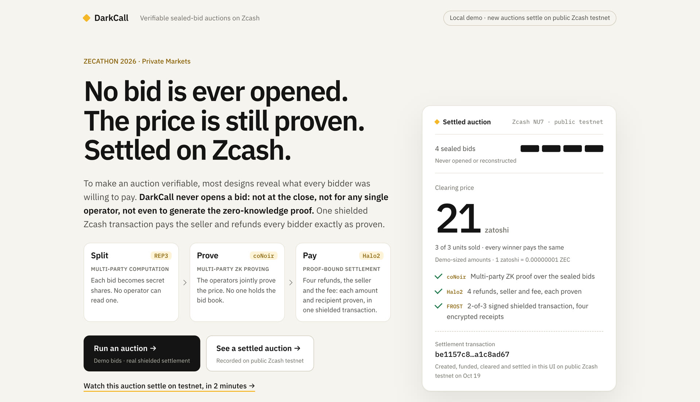

# DarkCall

*Private, verifiable sealed-bid auctions on Zcash.*

**DarkCall proves a sealed-bid auction's clearing price without opening a single
bid, and proves that the shielded Zcash payouts match it.**

ZECATHON 2026 · Private Markets ·
**[Live demo](https://49-12-250-128.sslip.io)** ·
**[Review guide](docs/judge-review.md)** ·
[Protocol](docs/design/protocol.md) ·
[Evidence](docs/evidence-index.md)

## Check it in five minutes

On the live demo, with nothing to install:

1. **[Verify a real Zcash settlement](https://49-12-250-128.sslip.io/demo/settled).** A real
   auction settled on public Zcash testnet. Look at it as the public, then open
   one bidder's encrypted receipt.
2. **Re-run verification** (about 20 s). The price, all six payouts, the Zcash
   transaction and the signed book are checked again on the server, with no
   secrets.
3. **Try to cheat.** Change one accepted bid, raise the price, or swap two payout
   proofs. Each change is refused by the check it targets.
4. **Inspect the proof trail.** The public data behind each claim, with 35
   consistency checks between the files and the transaction bytes.

With 25 minutes more, **[Run a new auction](https://49-12-250-128.sslip.io/demo/run)**
creates, funds, clears and settles a new auction on public testnet from the
browser. On your own machine, with the pinned tools installed
([reproduce](docs/run/reproduce.md)), `make verify` checks a recorded settlement.

## The problem, and the answer

| | Usually | DarkCall |
| --- | --- | --- |
| Checking the price | Every bid is opened after the close (commit–reveal, published viewing key) | A zero-knowledge proof; no bid is opened |
| Making that proof | The prover, or whoever decrypts, reads every bid | Three operators prove it together from secret shares (**coNoir** over **REP3** MPC); nobody holds the bid book |
| Paying out | A separate transaction, not checked against the result | One shielded Zcash transaction; a **Halo2** proof binds each of its six payouts to the result |

## One auction, in numbers

Four bidders seal 77, 61, 43 and 21 zatoshi for three slots, reserve 20.

1. **Seal.** Each bidder's client commits to its bid, splits it into REP3 secret
   shares for operators A, B and C (each holds two of three), and proves in Noir
   that the shares match the commitment.
2. **Fund.** Every ticket deposits the same 15,100 zatoshi into a 2-of-3 FROST
   escrow, so no deposit hints at its bid. All three operators sign the root of
   the accepted book, so a bid cannot be dropped quietly.
3. **Prove.** The operators compute the clearing price, 21, on the shares and
   generate one coNoir proof together.
4. **Settle.** One shielded NU7 transaction pays 79 back to each winner, 100
   back to the loser and 63 to the seller, plus the operator fee. Six Halo2
   proofs tie each output's amount and recipient to the proven result, and any
   two operators sign it with FROST. Each bidder decrypts only its own receipt.

**Public:** the terms, the price and units sold, the proofs and the transaction.
**Never published:** the bid book, the winners' bid ceilings, individual refunds,
who won, or any viewing key.
Every stage, with what is proven and what is trusted, is in the
[protocol](docs/design/protocol.md).

## Proven on public Zcash testnet

| Run | Settlement transaction | What it shows |
| --- | --- | --- |
| Oct 28 · live website | [`9d0869fa…63382976`](https://testnet.zecblock.com/tx/9d0869fa21ec41d2770284310f2c1292b69be513316ab0376269063f63382976) | Another new auction through the hosted demo, at a fresh price of 30; public check 16.6 s ([record](evidence/2026-10-28-hosted-testnet-auction-price-30.json)) |
| Oct 27 · live website | [`03feb02b…9cf72d8b`](https://testnet.zecblock.com/tx/03feb02b365a0f2a3df1bef3b338fdcd8689e2081981b0f896ad95269cf72d8b) | A new auction through the hosted demo, end to end in 24 min 16 s; public check 17.6 s ([record](evidence/2026-10-27-hosted-testnet-auction.json)) |
| Oct 19 · in the browser | [`be1157c8…a1c8ad67`](https://testnet.zecblock.com/tx/be1157c884ce015e87993f105ebf44c3ab7f78e895d783fd002948c3a1c8ad67) | The auction under Verify a real Zcash settlement ([record](evidence/2026-10-19-public-testnet-settlement.json)) |
| Oct 21 · one unit | [`1d85d98f…82db`](https://testnet.zecblock.com/tx/1d85d98f15691b06337f791d3d470cfd04de261f0ab057f763663ffc01d282db) | The same circuits settle one to three units ([record](evidence/2026-10-21-one-and-two-unit-settlement.json)) |

Every committed bundle verifies with no secrets: `make verify`, or
`scripts/docker_verify.sh` in a clean Linux container built from source.

## If an operator stops

Clearing needs all three operators, so DarkCall has a way out: the other two
return every deposit in one shielded transaction, signed 2-of-3 with FROST
without the stopped operator's key share. Each operator's journal reserves one
transaction for good, so a refunded book can never also settle. Run end to end
through the demo's HTTP API on regtest: operator C stopped, and A and B returned
all four 15,100-zatoshi deposits as 10,100 each (less a 5,000 share of the
network fee), leaving the escrow empty
([record](evidence/2026-10-24-cancel-refund.json),
[code](tools/nu7-compat/src/funded_cancel.rs)). Not yet run on public testnet.

## How it compares

| | **DarkCall** | Open on-chain auction | Commit–reveal or published viewing key | Operator decrypts after the close, then proves |
| --- | --- | --- | --- | --- |
| Bids hidden from the public | **Yes, never opened** | No | Only until the close | Yes |
| Bids hidden from whoever runs it | **Yes, from any single operator** | No | No | No |
| Anyone can check the price | **Yes, by ZK proof** | Yes | Yes, by opening every bid | Yes, by its proof |
| Payments and refunds stay private | **Yes, one shielded transaction** | No | If paid shielded | If it pays shielded |
| Payouts provably follow the result | **Yes, six output proofs** | Yes, by contract | By contract, or audited later | Only if proven too |

Common designs, not specific projects.

## What it does not prove

- Bid secrecy holds against one semi-honest operator (REP3). Two colluding
  operators can rebuild the bids.
- Two of the three FROST signers can move escrowed funds. A different payout
  fails public verification, but it is not prevented.
- Operators learn winners and refunds. By the auction rule the public price is
  the highest losing bid.
- The public check covers the operators' signed book. A dropped bid is visible
  to its own bidder, not to outsiders.
- The operator-stop refund has run on regtest only, not yet on public testnet.
- The demo runs every role on one server, including each bidder's client, which
  sees the demo bid typed into it. Four bids per auction; testnet coins only.

The full trust model, design choices and measurements are in
[DarkCall in detail](docs/details.md).

## Repository

| Path | Contents |
| --- | --- |
| `circuits/` | Noir circuits: the bidder's input proof, clearing and delivery, the six settlement rows |
| `crates/output-binding` | Halo2 proofs binding settlement rows to Zcash note commitments |
| `crates/native-gate`, `tools/nu7-compat` | NU7 transactions, DKG FROST, receipts and the public verifier |
| `crates/wallet-*` | Claims, acceptance receipts, journals, the signed book |
| `demo/`, `scripts/` | The web demo, its server and drivers, and the public bundles |
| `evidence/` | Public run records ([index](docs/evidence-index.md)) |

129 tests run on every push (34 Noir, 67 Rust, 28 Python). `make help` lists
the common commands. More in [docs/](docs/README.md). MIT licensed; upstream
components keep their own licenses ([dependencies](docs/run/dependencies.md)).
