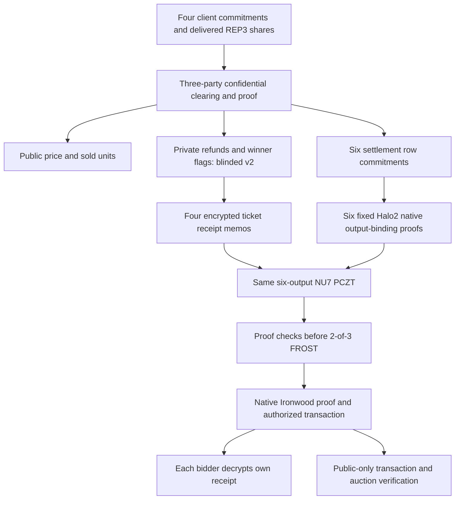

# DarkCall submission draft

Private uniform-price auctions with verifiable shielded ZEC settlement.

A seller offers three identical units. Four bidders commit their maximum price;
three REP3 parties compute the clearing price and prove the result without
reconstructing the bid list. Bidders pay one price; the seller payment, four
refunds and operator payment share one shielded transaction. Each bidder opens
an encrypted memo to verify only their own win/loss and refund.

This is a prototype for ZECATHON Private Markets. The human controls release,
video publication and submission. No contest win probability is asserted.

The graph describes the completed synthetic NU7 integration (transaction52555e25…151ab3b).
Signed funded admission, DKG and chain confirmations are demonstrated on an
older **separate** owned-regtest execution. They must not be attributed to this
NU7 transaction until connected and measured on that same run.

## Verified claims and remaining work

| Claim | Evidence / limit |
| --- | --- |
| Committed four-bid REP3 computation, standard C++ proof verification | Actual local processes; all parties on one host |
| Fresh blinded-v2 refunds and separate zero-price winner flags | Actual proof/opening and substitution checks; CSPRNG assumptions remain |
| Six row commitments bind native amounts, recipients, cmx and action indices | Fixed shared18 Halo2 circuit; native consensus does not enforce auction policy |
| Fresh funded v2 auction, DKG, signed admission, six receipts, two confirmations | Owned isolated NU6.3 regtest; separate from latest synthetic NU7 execution |
| Four memos inside latest six-output NU7 settlement | Passed in1015.173s; transaction52555e25…151ab3b, six recipient decryptions |
| Same-run recipient/client/public replay/UI | Passed against the same transaction; public replay99.323s, four ticket openings15.828s |
| Public-testnet funding and confirmation | Not demonstrated |
| Independent operator hosts, malicious MPC, production custody | Not demonstrated / not claimed |
| 8/16/32-bid scaling | Not measured; compiled production demonstration remains four slots |

## Threat model

REP3 bid secrecy assumes at most one semi-honest corrupt party. Two colluding
parties can reconstruct bids; all three are needed for computation. Custody
requires two signatures and two colluding signers can steal. Operators have
viewing capability and learn settlement refunds/status. Public clearing results,
small books and repeated auctions allow inference. We do not hide IPs/timing,
guarantee Sybil resistance or verify delivery of the sold item.

Fresh field masks require independent private commitment blinders. The old
deterministic commitment leaked two-candidate refunds; an actual public-transcript
attack reproduced it before the v2 fix. Do not describe fresh masks alone as
hiding. See [attack and fix](operator-fill-delivery.md).

Native binding proves classical note commitments; ciphertext generation and
rseed derivation are checked separately through the SDK/recipient, not constrained
by this application circuit. Public verification authenticates transaction effects
and proofs, not chain inclusion, spendability or public funding. Synthetic notes
must never be broadcast. The NU7 gate uses a local trusted dealer; historical
DKG does not convert it to a no-master-key setup.

## 90–120 second demo script

1. 0–15s: show four sealed bids and explain the single uniform price. Say that
   this is a recorded synthetic run, not a live funded network auction.
2. 15–35s: select one demo ticket, run the fixed proof verifier, decrypt its
   own native memo and show win/loss plus refund. Point out the exact transaction ID.
3. 35–50s: corrupt a proof; show refusal before recipient key access.
4. 50–105s: verify the **same** transaction's public bundle: native authorization,
   six output bindings, auction proof and receipt context. If verification exceeds
   the video length, show a clearly labeled recorded verification with its measured
   duration. Do not stage an artificial live success.
5. 105–120s: show the two trust thresholds and remaining funding/admission/chain
   integration. Provide the public verifier command and the actual latency table.

Canonical proofs can be generated beforehand; the demo must distinguish generation
from verification. Current latency is measured on a shared16GiB development Mac,
not a dedicated production server. Never claim a2-minute proof speed from a proposed
parallel layout.

## Reproduction and release checklist

`./demo.sh` starts the local canonical view when its ignored synthetic identity
fixtures exist. `./verify.sh PUBLIC_BUNDLE` needs only public artifacts and the
pinned compiled tools. Missing/wrong files and uploaded verification keys must
fail closed. The verifier does not discover authority keys in a supplied bundle.
Tool bootstrap/build steps are in [toolchains](toolchains.md) and [demo](demo.md).

Before release: replace pending rows with measured evidence; freeze the exact
canonical bundle; reproduce on a second machine; record witness/prove/verify/memory
and bytes; include license notices from [dependency inventory](dependencies.md).
Complete public-testnet/funded integration or keep it explicitly as a limitation.
Confirm official submission requirements; publish only after human authorization.

## Measured latency and scale

| Scope | Seconds / bytes | Interpretation |
| --- | --- | --- |
| Four-bid six-row REP3 witness |1.426s| Actual secret-shared witness |
| Four-bid six-row REP3 proof |8.359s /14656bytes| Three local parties |
| C++ auction verifier incl. negative statements |0.357s| Fixed matching compiled key |
| Cold native row PK |108.596s| One key reused within the six-row run |
| Six sequential row proof/verify services |667.790s /6×9504bytes| Shared16GiB M1, not isolated peak performance |
| Full synthetic NU7 execution |1015.173s /21790bytes| Includes repeated public checks/native authorization |
| Public-only replay |99.323s| No private material; includes fixed native verifier setup |
| Warm worker initialization |111.984s| One persistent same-circuit PK |
| Warm row0 jobs |82.310s /92.506s| Fresh proofs, same statement; no full-auction latency claim |
|2/3/6 workers|Not measured| Mac refuses parallel proving; sufficient Linux RAM required |
|8/16/32 bids|Not measured| Current fixed auction/settlement verifiers have four slots/six rows |

[Exact evidence](../evidence/2026-10-05-canonical-nu7-memo-auction.json) includes resource
samples and verification scopes. Warm proof row0 also passes the independent
public fixed verifier; production orchestration has not been switched to it.
