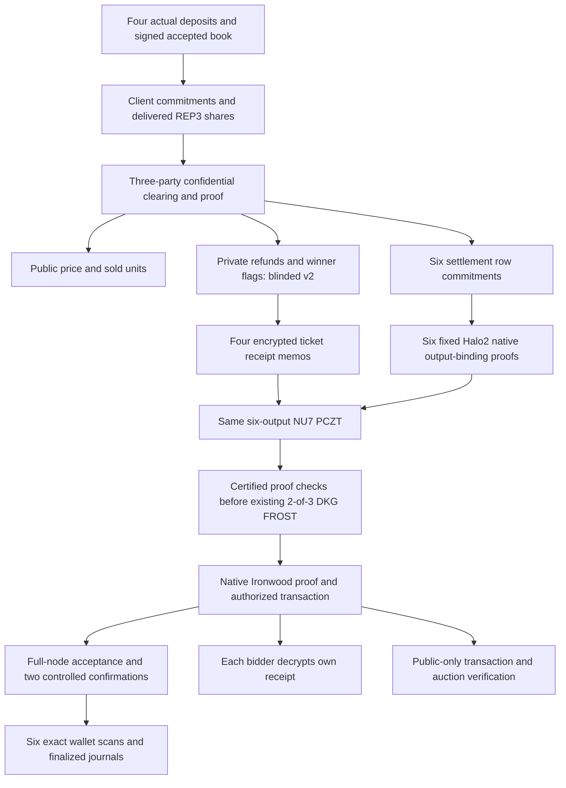

# DarkCall submission draft

Private uniform-price auctions with verifiable shielded ZEC settlement.

A seller offers three identical units. Four bidders commit their maximum price;
three REP3 parties compute the clearing price and prove the result without
reconstructing the bid list. Bidders pay one price; the seller payment, four
refunds and operator payment share one shielded transaction. Each bidder opens
an encrypted memo to verify only their own win/loss and refund.

This is a prototype for ZECATHON Private Markets. The human controls release,
video publication and submission. No contest win probability is asserted.

The graph describes one completed actual-funded NU7 execution, transaction
47019e02…a211938. The same transaction is used by the public bundle, recipient
clients and browser. All client fixtures/operators remain on one controlled host.
The separate historical synthetic/dealer transaction remains available for comparison.

## Verified claims and remaining work

| Claim | Evidence / limit |
| --- | --- |
| Committed four-bid REP3 computation, standard C++ proof verification | Actual local processes; all parties on one host |
| Fresh blinded-v2 refunds and separate zero-price winner flags | Actual proof/opening and substitution checks; CSPRNG assumptions remain |
| Six row commitments bind native amounts, recipients, cmx and action indices | Fixed shared18 Halo2 circuit; native consensus does not enforce auction policy |
| Current funded NU7 auction, existing DKG, signed admission/final root, six scans, two confirmations | SAME tx47019e02…a211938 on isolated Zebra7.0.0-rc.0 regtest; not public chain |
| Four encrypted receipt memos inside same funded six-output NU7 settlement | Exact prepared PCZT recovery1847.653s including chain/scans; no master SK/full ASK reconstructed |
| Same-run recipient/client/public replay/UI | Public replay112.431s; four own clients+6 substitutions22.247s; funded HTTP/public-only views pass |
| Public-testnet funding and confirmation | Not demonstrated |
| Independent operator hosts, malicious MPC, production custody | Not demonstrated / not claimed |
| 8/16/32-bid scaling | Not measured; compiled production demonstration remains four slots |

## Threat model

REP3 bid secrecy assumes at most one semi-honest corrupt party. Two colluding
parties can reconstruct bids; all three are needed for computation. Custody
requires two signatures and two colluding signers can steal. Operators have
viewing capability and learn settlement refunds/status. Public clearing results,
small books and repeated auctions allow inference. We do not hide IPs/timing,
guarantee Sybil resistance or verify delivery of the sold item.

Fresh field masks require independent private commitment blinders. The old
deterministic commitment leaked two-candidate refunds; an actual public-transcript
attack reproduced it before the v2 fix. Do not describe fresh masks alone as
hiding. See [attack and fix](operator-fill-delivery.md).

Native binding proves classical note commitments; ciphertext generation and
rseed derivation are checked separately through the SDK/recipient, not constrained
by this application circuit. Public verification authenticates transaction effects
and proofs, not chain inclusion, spendability or public funding. Synthetic notes
must never be broadcast. The funded NU7 gate reads only existing2-of-3 DKG packages, and no escrow master
SK/full ASK is reconstructed. All packages remain on one computer; the bank and
fixture recipient actors retain ordinary keys. The earlier synthetic gate uses
a local dealer. Recipient setup may read its own ordinary SK to derive the exported
FVK; the actual own-receipt client uses only that exported FVK. Funding provenance
is attested by the separately configured admission authority, not proved by the bundle.

## 90–120 second demo script

The seller/bidder entry is a separate offline rehearsal, not a new funded
execution. Its local helper sees typed demo maxima. Show that scope before input
and state the switch to the different recorded book before any result. The prior
result-only edited draft is preserved separately; the current110-second draft
includes the new entry and the explicit recorded-book transition.

1. 0–20s: create a local auction and seal a demo bid. Show fresh input proof,
   share checks and signed acceptance; deposits are synthetic.
2. 20–40s: explicitly switch to the different recorded funded regtest book;
   explain its single uniform price. Select one example ticket, verify and decrypt its
   own native memo and show win/loss plus refund. Point out the exact transaction ID.
3. 40–55s: corrupt a proof; show refusal before recipient key access.
4. 55–105s: verify the **same** transaction's public bundle: native authorization,
   six output bindings, auction proof and receipt context. If verification exceeds
   the video length, show a clearly labeled recorded verification with its measured
   duration. Do not stage an artificial live success.
5. 105–120s: show recorded local confirmations separately from public proof validity,
   the two trust thresholds and remaining public-testnet/independent-host work.
   Provide the verifier command and measured latency table.

Canonical proofs can be generated beforehand; the demo must distinguish generation
from verification. Current latency is measured on a shared16GiB development Mac,
not a dedicated production server. Never claim a2-minute proof speed from a proposed
parallel layout.

## Reproduction and release checklist

`./demo.sh` starts the local canonical funded view; a fresh checkout without
ignored identities switches to public-only. `./verify.sh --funded PUBLIC_BUNDLE
--authority TRUSTED_AUTHORITY` needs public artifacts, explicit separate authority
and pinned compiled tools. Missing/wrong files and uploaded verification keys must
fail closed. The verifier does not discover authority keys in a supplied bundle.
Fresh-source bootstrap/preflight/replay steps are in [reproduce](reproduce.md).
The [review entry point](judge-review.md) is included in the local committed-source
kit. A [captioned edited demo draft](demo-video.md) has source screenshots and a
reproducible renderer; it is explicitly separate from real-time proving.

Before release: replace pending rows with measured evidence; freeze the exact
canonical bundle; reproduce on a second machine; record witness/prove/verify/memory
and bytes; include license notices from [dependency inventory](dependencies.md).
Public-testnet/independent-host integration remains an explicit limitation.
Confirm official submission requirements; publish only after human authorization.

## Measured latency and scale

| Scope | Seconds / bytes | Interpretation |
| --- | --- | --- |
| Same prepared funded NU7 recovery incl. controlled confirmation/scans |1847.653s /21790bytes| Shared16GiB M1, one native thread;190.563s stopped attempt excluded |
| Native key / six sequential row services in funded recovery |201.875s /1295.846s| Same circuits; paging, not isolated speed comparison |
| Actual funded REP3 witness / proof |1.423s /10.824s| Three local parties;14656-byte proof |
| Funded public-only replay / full HTTP replay |112.431s /110.112s| No private material; certificate under separate authority; no inclusion proof |
| Four own clients plus six substitutions |22.247s| Own exported FVK only; proof/certificate refusal before key access |

Historical synthetic/warm measurements remain separate:

| Scope | Seconds / bytes | Interpretation |
| --- | --- | --- |
| Four-bid six-row REP3 witness |1.426s| Actual secret-shared witness |
| Four-bid six-row REP3 proof |8.359s /14656bytes| Three local parties |
| C++ auction verifier incl. negative statements |0.357s| Fixed matching compiled key |
| Cold native row PK |108.596s| One key reused within the six-row run |
| Six sequential row proof/verify services |667.790s /6×9504bytes| Shared16GiB M1, not isolated peak performance |
| Full synthetic NU7 execution |1015.173s /21790bytes| Includes repeated public checks/native authorization |
| Public-only replay |99.323s| No private material; includes fixed native verifier setup |
| Warm worker initialization |111.984s| One persistent same-circuit PK |
| Warm row0 jobs |82.310s /92.506s| Fresh proofs, same statement; no full-auction latency claim |
|Warm full service: two books|901.704s /823.613s| One PK,12 fresh rows; clearing13.032s/8.163s |
|Warm full service initialization|122.447s| Params92.015s/VK13.077s/PK17.355s before job requests |
|2/3/6 workers|Not measured| Mac refuses parallel proving; sufficient Linux RAM required |
|8/16/32 bids|Not measured| Current fixed auction/settlement verifiers have four slots/six rows |

[Current exact evidence](../evidence/2026-10-05-canonical-funded-nu7-memo-auction.json)
records the one funded run and its remaining limits.
[Historical synthetic evidence](../evidence/2026-10-05-canonical-nu7-memo-auction.json) includes resource
samples and verification scopes. Warm proof row0 also passes the independent
public fixed verifier. An opt-in complete synthetic warm service now passes
two distinct books; see [warm full evidence](../evidence/2026-10-05-warm-full-nu7-auctions.json).
The ordinary command still uses its cold path; neither timing is a production benchmark.
